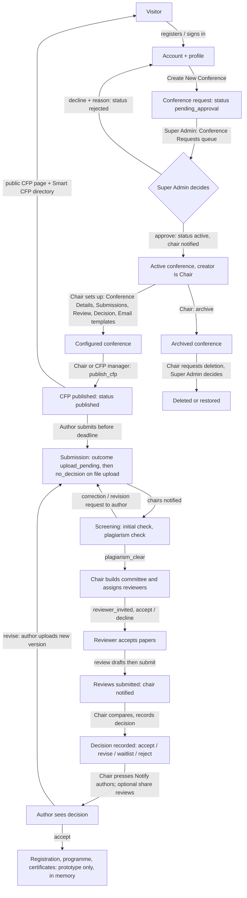

# C. Cross-role workflows

Only sequences supported by the actual implementation are included. "DB" = enforced by Supabase (migrations); "UI" = enforced only in the prototype front-end; "MEM" = prototype in-memory / sample only.

## C1. Diagram (what connects to what)

## C2. Sequences in detail

### 1. Conference creation and approval
1. **Who:** any signed-in user. **Where:** Create New Conference. **Required:** website, title, acronym, end date, primary and secondary area, event format, city, country, contact email, policy tick (checklist in `CreateConferencePage`).
2. **Real account (database mode):** `createConference` inserts a `conferences` row with `status = pending_approval`, slug from the acronym (suffix -2..-5 on a clash), extras in `details`. `conference_requested` email tells the Super Admin. The same insert fires `handle_new_conference` (`0001`): the creator becomes an **active chair immediately (before approval)**, **8 default decision types** are seeded (Paper Upload Pending, No Decision, Plagiarism clear, Revision, Waitlist, Accept, Registered, Reject), a draft `cfps` row is created and every Super Admin gets a `conference_request` notification. When the conference later becomes `active`, `handle_conference_live` copies the platform email templates into it (`copy_email_templates`, `0005`).
3. **Sample mode:** the conference is created at once and the person lands in its Conference Details (no approval step).
4. **Super Admin:** Conference Requests queue: Approve, or Decline with a reason (or Ask for info, sample only). `decide_conference_request` sets `active` / `rejected`, stores `admin_note`, inserts a `conference_decision` notification for the creator; `conference_decided` email.
5. **Requester sees:** pending / rejected rows under My Requests; an approved one moves to My Conferences. (Request detail with correspondence and Cancel exist only in the in-memory bridge.)
6. **Sample-only extras:** license trial of 30 days (`licenseExpiry`) and License Extensions queue; the database has **no licence column**.

### 2. CFP publication and opening of submissions
1. **Who:** Chair or CFP manager (`publish_cfp`). **Condition (DB):** the conference must be `active` (approved). The prototype's CFP suite also covers wizard content, themes, logo, managers; `CFP Page Review` in the Super Admin console is **not** part of the database rule (conflict, see H).
2. **Effect (DB):** a `cfps` row `status = published`. Authors can insert submissions **only if** the conference is `active` **and** the CFP is `published` **and** `now() <= submission_deadline` (policy `submissions: author creates`, `0006`). A published CFP is publicly readable (`cfps: public read published`, includes `closed`).
3. **Close:** `close_cfp` (only from `published`) sets `closed`. A chair may still submit on an author's behalf after the deadline (`0021_chair_submit_after_deadline`).
4. **Public side:** public CFP page and Smart CFP directory list published conferences.

### 3. Author submission
1. Author opens `/submit/<conference>` (only offered while the CFP is open; otherwise `SubmissionsNotOpen`).
2. Duplicate check (`check_duplicate_submission`), upload to bucket `papers` (private; PDF / Word, 25 MB), authors saved (`submission_authors`, linked to accounts by email), conference's extra questions saved. A paper number is assigned by trigger (`assign_paper_no`, per-conference prefix).
3. **Status model:** `submissions.status` (draft / submitted / withdrawn) and `submissions.outcome` (`upload_pending` → `no_decision` when a paper / revision / camera-ready file is added, trigger `handle_paper_uploaded`).
4. **Side effects:** chairs get a `new_submission` notification; the author gets `submission_received` (email); co-authors get `coauthor_added`.
5. **Draft:** the prototype can keep a draft (`upload_pending`) and "Continue editing & submit".

### 4. Initial screening
1. Chair switches Initial Check and / or Plagiarism Check on in Settings › Submissions; the Screening group then appears in the menu.
2. Chair opens the paper's check, applies criteria (editable text, written in English, iThenticate report added manually, AI screening via `screen-paper`), confirms an outcome; stored per paper version in `submissions.screening` (`save_screening`).
3. Outcomes lead to: **pass** (`plagiarism_clear` stage: reviewers can be assigned; email `screeningPassed`), **correction needed** or **revision needed** (author email `screening_notified`; reminder and last-chance emails; deadline in a notice on the author's paper page; author uploads a corrected file).
4. Reopen is possible; email drafts are editable before sending (prototype).

### 5. Reviewer committee and assignment
1. Chair adds a reviewer by email (`conference_members` row `invited`, `reviewer_invited` email + `member_invited` notification). If the person has no account yet, assignments can be **queued** in `pending_review_assignments`.
2. Reviewer accepts or declines on My Conferences (`respond_to_invitation`): decline returns any waiting papers; accept turns queued papers into review requests; chairs get `invitation_answer`.
3. Chair assigns papers (manual, bulk, or auto-assign in the prototype) → `review_assignments` `assigned`, trigger `notify_review_assigned`, `reviews_assigned` email.
4. Reviewer accepts or declines each paper (`respond_to_assignment`, reasons); a decline notifies the chair (`assignment_declined`, "Find a replacement").
5. Withdrawing a paper removes it from reviewers' queues (assignments `removed`; submitted reviews stay).

### 6. Review submission
1. Reviewer opens the review form (draft autosave in memory and, for real accounts, in the database); required fields per the conference's review form; submit → trigger sets `submitted_at` and the assignment to `submitted` (`handle_review_submitted`).
2. Chair receives `review_submitted` (email + notification). The chair can edit a review or add one on a reviewer's behalf (`chair_edit_review`, `chair_submit_review`; reviewer is told `review_edited`).
3. Reviewers' reviews are **private to chairs** until the chair shares one (`set_review_shared`, view `author_reviews` for authors). Review locks after the paper is decided.

### 7. Chair evaluation, decision and notification
1. Chair sees reviewers and scores, compares, and **records a decision** by choosing one of the conference's decision types (`record_decision`): each type has an outcome (accept / revise / waitlist / reject, plus the stages), a colour and an author-facing wording. A desk reject records Reject with a reason.
2. Recording is **silent**: the authors still see the previous state. **"Notify authors"** (`notify_decision`) copies the outcome to `notified_*`, writes the note and sends the decision email (acceptance, minor / major revision, waitlisted, rejection; `decisionChanged` if changed) plus a `decision` notification.
3. Reviewers are told the final decision (`finalDecisionReviewers`, catalogue; server wiring UNKNOWN).
4. Withdrawal rules (DB): an author cannot withdraw after being told a rejection; a chair cannot withdraw a paper already recorded as rejected.

### 8. Revision and resubmission
1. A `revise` outcome tells the author to upload a revised file. The author uploads a new version (`addPaperVersion`, file kind `revision`); email `paper_revised` to the chair.
2. What happens to the outcome after a revision upload: **UNKNOWN**. The only trigger moves `upload_pending` to `no_decision`; whether a revised paper returns to review is not enforced by the database and I did not find a UI rule (the chair re-assigns and re-decides by hand).

### 9. After a decision (prototype only)
- Registration: accepted authors register (form built by the chair, fee by type, payment method choice with a PayPal surcharge in the UI); outcome `registered` can be recorded. In memory.
- Programme: chair builds sessions and assigns papers; author "book a slot" action leads to a route with no page.
- Certificates: chair designs and distributes five certificate types; verification page by serial / QR. In memory.
- Speaker flyer, feedback, analytics. In memory.
- **Camera-ready / proceedings:** only a deadline field, an email template (`cameraReadyReminder`, display-only), a file kind (`camera_ready`) and a CFP "proceedings will be published in…" sentence. No dedicated camera-ready collection or proceedings generation exists (the marketing page claims one).

### 10. Conference closure
Chair archives (`archive_conference`), may **request deletion** of an archived conference (`request_conference_deletion`); Super Admin approves / rejects (`decide_conference_deletion`; emails `deletionApproved` / `deletionRejected`); the chair may cancel the request; a deleted conference can be restored (`restore_deleted_conference`).

### 11. Account-level cross-cutting
- **Notifications:** 10 database kinds (`conference_request`, `new_submission`, `member_invited`, `review_assigned`, `conference_decision`, `invitation_answer`, `assignment_declined`, `withdrawn`, `review_edited`, `coauthor_added`) plus `decision`; the prototype also keeps in-memory alerts (announcements, achievements).
- **Emails:** 72 templates in the catalogue; 19 events have a server handler; 1 scheduled function (review reminders). The rest are shown in the UI as "emails this action sends" but nothing sends them.
