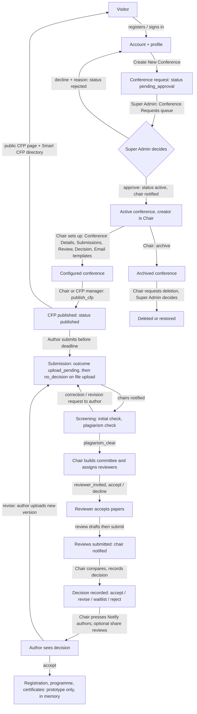

---
<!-- source: README.md -->

# Workflow discovery – index

Read-only investigation. No application source, prototype, env file, migration or Supabase resource was changed; no secrets read; no commit, push or deploy.

| File | Deliverable |
|---|---|
| A_B_overview_and_role_workflows.md | A overview, B role workflows |
| C_cross_role_workflows.md | C cross-role workflow diagram + sequences |
| D_E_feature_inventory_and_status.md | D feature inventory, E prototype vs Next.js |
| F_business_rules_and_backend.md | F business rules and backend |
| G_corrected_roadmap.md | G roadmap |
| H_risks_and_approvals.md | H risks and approvals |

**Method:** prototype routes, components, data calls and `supabase/migrations` read from files; Next.js `src` searched for routes and RPCs; helper scripts (outside the repo) indexed components.
**Limits:** statuses mean "no known gap", not field-level audit (only Login, Register, Reset password, Create Conference, header, Notifications were audited). Some descriptions came from earlier-session notes and were cross-checked for presence only. Live DB state, Netlify env and provider settings were not inspected.

---
<!-- source: A_B_overview_and_role_workflows.md -->

# A. Application overview and B. Role-by-role workflows

Everything below was read from source (prototype `src/`, `supabase/migrations/`, `netlify/functions/`, Next.js `frontend/src/`). Nothing was run against a real Supabase project. "(src: file:line)" points at the evidence. Items I could not verify are marked **UNKNOWN**. Method and limits: see `README.md`.

## A. Application overview

### A1. What exists (four front-ends, one backend)
| Part | Entry | What it is | Data |
|---|---|---|---|
| **Main app ("the prototype")** | `/prototype/*` (`src/author-journey.jsx`, 40,678 lines + modules) | Account, My Conferences, and per-conference workspaces for Author / Reviewer / Chair, plus a CFP suite, event-operations modules and account extras. 85 page keys (`pathToRoute`, `SIMPLE_PAGES`; render switch at `author-journey.jsx:40300-40620`). | **Two modes** (`VITE_USE_DATABASE`): sample data (in memory, any login works, 3 demo logins) or Supabase for the "core flow" only. |
| **Super Admin console** | `/super-admin` (`src/super-admin/`, ~7,100 lines) | A separate SPA with its own sign-in (password + emailed one-time code). | In database mode **only some pages are live** (see B6); the rest run on sample data and say so (`SuperAdminApp.jsx:36-39`). |
| **Smart CFP directory** | `/smart-cfp` (`src/smart-cfp/`, 1,210 lines) | Public directory of calls for papers (list, detail, date-range filter). | Reads the `conferences` table in database mode (`smart-cfp/data.js:79-81`). |
| **Marketing home** | `/` (`index.html`, static + two scripts) | Landing page: workflow, features, roles, pricing, security, FAQ. Every call to action goes to `/prototype/`. | None. |
| **Netlify functions** (server) | `netlify/functions/*.mjs` (10) | `send-email`, `send-review-reminders` (daily cron 06:00 UTC), `extract-paper`, `extract-conference`, `suggest-topics`, `screen-paper`, `paper-chat`, `enhance-review`, `ingest-paper-background`, `orcid-link`. | Service-role Supabase access and AI (Anthropic / Voyage) on the server. |
| **Supabase** | `supabase/migrations/0001-0030` | 25 tables, ~55 functions (RPC and triggers), 56 RLS policies, 2 storage buckets. | The only persistent store. |
| **Next.js frontend** (the port) | `frontend/` (own git repo, gitignored in the prototype repo) | Ports a subset of the main app against the same Supabase project; calls the prototype's Netlify functions through proxy routes (`app/api/ai/[name]`, `app/api/send-email`). | Supabase (real) or typed mocks (QA only). |

### A2. Roles that actually exist
Roles are not one concept; four different mechanisms exist.

| Role | How it is established (evidence) | Has its own UI? |
|---|---|---|
| **Author** | *Derived*, not a stored role: the submitter of a paper (`submissions.submitter_id`) or a listed co-author (`submission_authors`); `is_submission_author()` (`0001`). Co-authors are linked by email when they register (`link_submission_author`, `claim_my_papers`, `0009`). | Yes: Author workspace (sidebar `AUTHOR_SIDEBAR_ITEMS`, `author-journey.jsx:11086`). |
| **Reviewer** | `conference_members.role = 'reviewer'` with `status` invited / active / declined / removed (`member_role`, `member_status`, `0001`). A reviewer for a conference is added by a chair (invitation) and must accept. A paper is then *assigned* (`review_assignments`, status assigned / accepted / declined / submitted / removed). | Yes: Reviewer workspace (`REVIEWER_SIDEBAR_ITEMS`, `:11096`). |
| **Chair** | `conference_members.role` in (`chair`, `track_chair`); `is_chair(conf)` is also true for a Super Admin (`0001:279-282`). The creator becomes chair when the conference is created (`handle_new_conference`). | Yes: Chair workspace (`CHAIR_SIDEBAR_ITEMS`, `:11018`). `track_chair` has **no separate UI** (0 matches in the prototype UI; "Track Chair" appears only as display text). |
| **CFP manager** | `conference_members.role = 'cfp_manager'`: may publish / close the CFP (`publish_cfp`, `close_cfp`). | The prototype's *CFP Managers* pages add "managers" with permissions (`AddCFPManagerPage`); how they map to `cfp_manager` is **UNKNOWN** (0 matches for `cfp_manager` in the UI). |
| **Committee member** | UI only: `role: "committee"` (62 matches). Opening it shows `RoleComingSoonPage` (26 lines) = "coming soon". **No database role.** | Placeholder page only. |
| **Super Admin** | `profiles.is_super_admin = true` (`is_super_admin()`, `0001:266`). Separate console and session (`grs_admin_signed_in`; `adminSupabase`). Sign-in = password then emailed code, or a fixed test code in development (`data/adminAuth.js:1-16`). | Yes: `/super-admin` (see B6). |
| **Visitor (public)** | No account: public CFP page, public author profile, certificate verify page, Smart CFP directory, marketing home, `/terms`, `/privacy`. | Yes (read-only pages). |
| **Registrant / attendee** | Not a role: the author-side registration form (`RegistrationFormPage`, `:29249`) and chair Registration module are in-memory; there is no registrant table. | Form only (prototype). |

Demo logins (sample mode only): `chair@…`, `author@…`, `reviewer@…` (`DEMO_ACCOUNTS`, `:2154`) and `admin@…` for the console (`adminAuth.js`). Which workspace a person sees is decided per conference: one account can be Author, Reviewer and Chair of different conferences (My Conferences lists roles per conference; `MY_ROLES`, `ROLE_CONFIG`).

### A3. Persistence reality (what is real and what is sample)
| Area | Persists in Supabase (database mode)? | Evidence |
|---|---|---|
| Accounts, profile (core fields + JSON detail), photo | Yes | `data/auth.js`, `profiles`, `profile_details`, bucket `public` |
| Conferences: request, approve / decline, settings, archive, delete request / restore, CFP publish / close | Yes | `data/workspace.js` + RPCs `decide_conference_request`, `publish_cfp`, `close_cfp`, `archive_conference`, `request_conference_deletion`, `decide_conference_deletion`, `restore_*` |
| Submissions, files, authors, withdrawal, versions, screening records | Yes | `submitPaper`, `uploadPaperFile`, `addPaperVersion`, `save_screening`, `withdraw_submission` |
| Reviewer invitations, assignments, reviews (draft + submit), chair edit / add review, share with author | Yes | `respond_to_invitation`, `respond_to_assignment`, `reviews`, `chair_edit_review`, `chair_submit_review`, `set_review_shared` |
| Decisions, decision types, notify authors | Yes | `record_decision`, `notify_decision`, `decision_types`, `decision_events` |
| In-app notifications (10 kinds), email log, email templates, conference settings / forms | Yes | triggers and `notifications`, `email_log`, `email_templates`, `conference_settings`, `conference_forms` (0028) |
| **Registration, pricing, payments, receipts** | **No** (in memory) | no table; `chair-certificates`, `chair-programme`, `chair-analytics` have 0 database calls |
| **Programme / sessions / slot booking** | **No** | same |
| **Certificates (design, distribution, verification)** | **No** | same |
| **Speaker flyer, feedback, achievements / reviewer journey, watchlist, preprints, slides, Publish with Us, activity logs, announcements, billing / licence, societies / institutions / research-area master data, profile verification, claim reports** | **No** (in memory / localStorage) | no table in the 25 (list in F1) |

---

## B. Workflows by role

### B1. Visitor / account (everyone)
- **Landing:** marketing home `/`, or `/prototype` login.
- **Sign in** (`LoginPage`, `:4167`): email + password; "Email me a login code" (one-time code by email); "Forgot password?" (reset link); SSO buttons Google, ORCID, Microsoft, GR Connect (real providers configured in code for Google, Microsoft (`azure`) and ORCID (`custom:orcid`); GR Connect has none, so it says "coming soon"); sample mode adds the demo-logins box. Unconfirmed accounts get "Resend confirmation email". Terms / privacy consent line.
- **Register** (`RegisterPage`, `:4346`): photo (with cropper), first / last name, email, affiliation (institution search), department, designation, country (searchable), gender, website, mobile (+ dial code, SMS / WhatsApp opt-in), password pair; Terms tick; button counts missing fields ("Fill in N more fields"); confirmation email, then "Check your email".
- **Reset password** (`ResetPasswordPage`, `:4640`): reached from the emailed link; expired / used link shows an explanatory state.
- **Complete profile** (`complete-profile`): required for SSO users who still owe the sign-up details (`profilePending`); the app is gated until done (`guardPage`, `:38311`).
- **Profile** (`ProfilePage`, 647 lines): sections Intro, About, Affiliations, Education / experience lists, Emails (two verified slots), Phone, Address, scholar and professional links (Google Scholar, ORCID, DBLP, Scopus, OpenAlex, LinkedIn…) with "Find / Connect / Confirm / Request verification" (verification requests go to the Super Admin queue), Share (public profile link, QR, vCard), photo with cropper.
- **Security & Settings** (tab in the same page): change password, linked sign-in methods, **merge accounts**, **delete account**, notification channels and frequency (instant / daily / weekly / off), display (timezone, colour-blind mode).
- **Notifications** (`alerts`): 4 tabs (all, paper updates, announcements, emails), read / unread, dismiss, mark all, conference filter; header bell with unread count; "profile complete" pill and avatar menu in the header.
- **Public pages:** public author profile (`/author/<slug>`), public CFP page (`/cfp/<slug>`), certificate verification (`/verify/<serial>`), `/terms`, `/privacy`.

### B2. Account-level workspace (any signed-in user)
- **My Conferences** (`DashboardPage`): four layouts `/dashboard` (= D, client-approved), `/a`, `/b`, `/c`; filters (role, status, certificate), pinned conference, invitation strip / Invitations tab (Pending + History) with accept / decline and the **Reviewer onboarding modal** (choose expertise, optional save to profile) on accept (`ReviewerOnboardingModal`, `:6185`); a role "Enter" button per conference.
- **Menus** (top bar): Conferences (My Conferences, Create New Conference, My Requests), Calls for Papers (My CFP, Smart CFP), Publishing (Publish with Us, My Preprints, My Slides), My Account (My Certificates, My Achievements, My Receipts, Terms of Service) (`:3457-3478`).
- **Create New Conference** (`CreateConferencePage`, 903 lines): type (conference / book / journal special issue / journal / other), website with **Smart Fill** (AI read of the site, undo), title, acronym (+ suggestion chip), timezone picker (follows country), dates, About (1,200 words), primary / secondary area, event format; venue (Places search) and venue address (map picker) once the format is not Virtual, city, country, state, postal code, contact email; policy tick; live preview and "Required to create" checklist; saved draft, leave guard, Clear form; sample mode creates the conference at once, a real account **sends it for approval** ("Send for approval"; `createLiveConference`, `conference_requested` email).
- **My Requests** (`MyConferenceRequestsPage`) and **request detail** (`ConferenceRequestDetailPage`, 356 lines): status (pending / awaiting reply / approved / rejected / cancelled), correspondence with the Super Admin, cancel request. The correspondence and cancel exist only through the in-memory admin bridge; the database only holds pending / rejected requests and an admin note.
- **CFP suite** (My CFPs list, create, new-CFP wizard of 5 steps, content creation from empty / template / existing CFP, content editor, draft view, public page): see B4.
- **Extras (all in memory):** Publish with Us (publishing proposals, 769 lines), My Preprints + create (wizard), My Slides + create, My Receipts (invoices / payment history), My Certificates, My Achievements, CFP Watchlist, global My Submissions list, Help, Terms of Service.

### B3. Author (per conference)
- **Landing:** conference Dashboard (`AuthorConferenceOverview`; four home layouts selectable by URL `/conference/<id>/author/a-d`; key dates, status, announcements).
- **Menu:** Dashboard, My Submissions, My flyer, Certificates, Feedback, Updates, Activity Log (`:11086`).
- **New Submission** (`SubmitPaperPage`, 404 lines; `/submit/<id>`): only while the CFP is published and the deadline has not passed (RLS `submissions: author creates`, `0006`); upload (PDF / Word, 25 MB bucket limit), AI form fill from the paper (`extract-paper`), type and track, title, abstract, keywords, authors (name, email, affiliation, country, corresponding), conference's extra questions (`conference_forms`), duplicate check (`check_duplicate_submission`), guidelines; **Save as Draft** (status `draft`, outcome `upload_pending`) and "Continue editing & submit". Emails: `submission_received` (and `submission_on_behalf` when a chair submits for someone: Chair "Submit on behalf").
- **My Submissions** (cards / table, filters): result badge in plain words (Paper Upload Pending, Under review, Accepted – registration pending, Accepted & registered, Not accepted).
- **Paper page** (author view): header, timeline, presentation panel (book a slot), correction / revision notice from screening, abstract / authors / files, chair note and **shared reviews** (only reviews the chair shared), actions: **edit details, edit / add authors, upload a new version or supporting document, withdraw** (`withdraw_submission`; refused after a final decision the author has been told).
- **After the decision:** the outcome text is the decision type's author label; accepted: registration (author registration form, fee by type and payment method, in memory); presentation slot booking (the "Book slot" action navigates to `programme-booking`, **a route with no page**); speaker flyer; certificates; feedback form; Updates and Activity Log.
- **Notifications and emails** seen by authors: submission received, edited, withdrawn, on behalf, screening correction / revision (+ reminders), decision emails (acceptance, minor / major revision, rejection, waitlisted, decision changed), co-author added, registration confirmed (display-only), camera-ready reminder (display-only).

### B4. Chair (per conference)
- **Landing:** Chair Dashboard (`ChairConferenceOverview`): setup / completeness ring and checklist, submission link card (closed / not published / published), "Needs your attention" rows, metrics strip with sparkline, score distribution, recommendation bars, top topics, recent submissions, readiness ring, key dates, reviewer workload, registrations card, quick actions, recent activity.
- **Menu** (`:11018-11080`): Dashboard; Call for Papers; Submissions (List, Manage, Email Communication); Screening (Initial Check, Plagiarism Check; each shown only while on in Settings); Peer Review (List, Reviewers, Manage); Registration; Program (Overview, Full Program, Manage); Certificates (Design, Distribute); Speaker Flyer; Analytics; Conference Settings (Conference Details, Submissions, Review, Decision, Email Templates, Activity Logs, Email Logs). "Payment" and "Communications" are announced as coming soon.
- **Call for Papers manager** (7 pages): CFP Manager (status, content, close CFP), Edit details, Theme (5 themes: Classic, Easy, Blue, Sandy, Red), Logo, Publish (choose the public CFP page; `publish_cfp`), Managers (list, permissions) and Add Manager (manual or from Program Committee; invitation email). CFP states in the database: draft, in_review, published, closed (rejected exists in the enum). **Publishing needs an approved (active) conference** and is done by a chair or CFP manager directly (`publish_cfp`, `0006`).
- **Submissions:** List (columns picker, saved views, filters, selection with Contact / Assign reviewers / Add to sessions / Edit decisions / Edit track / Delete); Manage (Submission Form editor "Author's view", Submission Settings: period, numbering & limits, guidelines, tracks, presentation types); Email Communication (compose, templates by category, history). **Submit on behalf of an author.**
- **Screening:** Initial Check and Plagiarism Check tables, per-paper pages, criteria dialog, confirm outcomes, email drafts to the author (main / reminder / last chance; correction vs revision), reopen, bulk confirm, iThenticate report upload (manual) and AI screening (`screen-paper`). Stored in `submissions.screening` (jsonb per paper version; `save_screening`).
- **Peer Review:** List (buckets Needs reviewers / In progress / Needs my decision / Decided; assign, auto-assign, add reviewers, bulk assign, reminders, notify authors, edit decisions, screening report); Reviewers (committee table: invite, edit, remove, assign papers); Manage (review form preview, all reviews, CSV).
- **Paper page** (two pages in the prototype: details with "Manage submission", and the review view): Reviewers & Scores (share with author switch), compare reviews, **record decision** (decision types), **notify authors**, desk reject, add / edit review for a reviewer, send reminder, extend deadline, message reviewer, find a replacement (declined assignment), ask author to fix, update submission / authors / files, withdraw, email authors.
- **Registration** (in memory): registrations table, settings (period), form builder (Physical / Virtual types), pricing editor and participant pricing, confirmation email, CSV export.
- **Program** (in memory): overview (needs attention, by day, room mix), full program, manage sessions (generate, add, edit, delete, assign papers).
- **Certificates** (in memory): design (5 types: presentation, author, publication, participation, appreciation; templates; designer with drag layout, logo, wording, signatures), distribute (audience, email preview, recipients list, add person, send), public verification by serial / QR.
- **Speaker flyer, Analytics** (in memory): flyer designer / publish; analytics 9 tabs (Overview, Submissions, Authors, Institutions, Countries, Region, Master Data, Review, Trends).
- **Settings:** Conference Details (6 sections: CFP managers, publishing intent, dates & deadlines, website & description, license & contact, topics & research areas; archive, request deletion, restore), Submissions, Review (reviewing period, timeline, assignment, visibility, instructions, form), Decision (decision types: drag order, outcome, colour, author wording; decision emails), Email Templates (platform copies per conference), Activity Logs (sample only), Email Logs.
- **Rules:** all chair actions require `is_chair(conference)`; a decision is a **record** (reversible, `decision_events` history) and **authors learn it only after "Notify authors"** (`notified_*` columns); reviews reach authors only when the chair shares them; screening and decision stages that are not decisions: `upload_pending`, `no_decision`, `plagiarism_clear`.

### B5. Reviewer (per conference)
- **Landing:** Reviewer Dashboard (`ReviewerConferenceOverview`: waiting-for-your-response, assigned papers table, progress).
- **Menu:** Dashboard, My Reviews, Certificates, Updates, Activity Log (`:11096`).
- **Invitation:** email `reviewer_invited` + notification; accept or decline on My Conferences (decline reason; onboarding modal on accept). Accepting turns any papers the chair queued earlier into review requests (`pending_review_assignments`); declining returns waiting papers (`respond_to_invitation`, `0019`).
- **Assignment:** accept or decline each paper (reasons: Conflict of interest, Outside my expertise, Not enough time, Other); a decline notifies chairs (`assignment_declined`).
- **Review form** (`ReviewerReviewFormPage`, 420 lines): paper pane (PDF reader with search / zoom, "Ask a question" paper chat), abstract card, reviewer instructions, fields from the conference's review form (rating criteria, recommendation accept / revise / reject, confidence low / medium / high, comments to author, comments to chair; "Comments to author" optional), **autosaved draft** (also in the database for real accounts), progress ("n of N required fields answered"), Save & close, Submit / Update, AI review help (`enhance-review`), "Ask for more time" (extension request), other reviewers' reviews, celebration modal and XP / levels / badges (Reviewer Journey, in memory). **Locked** once the paper is decided and a review exists.
- **Rules / emails:** reviewers see only their assigned papers (`is_assigned_reviewer`); double-blind setting (`review_mode`); due-soon / last-day reminders by a daily function; thanks, locked, edited-by-chair, deadline-extended emails exist in the catalogue (most display-only).

### B6. Super Admin (separate console)
- **Landing:** Dashboard (live in database mode).
- **Sidebar** (`SuperAdminApp.jsx:82-106`): Overview (Dashboard, Conferences, Billing, Users), Communication (Announcements), Approvals (Conferences group: Conference Requests, Deletion Requests, License Extensions, CFP Page Review; People group: Profile Verification, Claim Reports; Names & lists), Master data (Societies, Institutions, Research Areas), Settings (Email Templates), Admin (Team & Roles, Audit Log); Ctrl-K search palette; step-up confirmation dialog for sensitive actions.
- **Live in database mode** (`isLivePage`, `:38-39`): Dashboard, Conferences (+ detail, archive / restore), Users (+ detail), Papers (detail), the **Conference Requests** queue (approve / decline with reason; `decide_conference_request`; emails `conference_decided`), the **Deletion Requests** queue (`decide_conference_deletion`, `conference_deletion_decided`) and platform **Email Templates** (`email_templates`).
- **Sample data only:** License Extensions, CFP Page Review, Profile Verification, Claim Reports, the six "Names & lists" queues (societies, institutions, departments, grades, affiliation types, research areas), Billing, Announcements, Master data pages, Team & Roles, Audit Log. Queue actions: approve / decline / reject / merge / correct & approve / ask for info / send back / publish / dismiss / remove link / remove & lock.
- **Conflict to flag:** the console has a **CFP Page Review** queue ("Approve & publish" / "Send back") but in the database a chair publishes the CFP directly (`publish_cfp`) with no admin step.

### B7. Committee member
Only the placeholder `RoleComingSoonPage` (`/role-coming-soon/<conference>/<role>`). No workflow exists.

---
<!-- source: C_cross_role_workflows.md -->

# C. Cross-role workflows

Only sequences supported by the actual implementation are included. "DB" = enforced by Supabase (migrations); "UI" = enforced only in the prototype front-end; "MEM" = prototype in-memory / sample only.

## C1. Diagram (what connects to what)

## C2. Sequences in detail

### 1. Conference creation and approval
1. **Who:** any signed-in user. **Where:** Create New Conference. **Required:** website, title, acronym, end date, primary and secondary area, event format, city, country, contact email, policy tick (checklist in `CreateConferencePage`).
2. **Real account (database mode):** `createConference` inserts a `conferences` row with `status = pending_approval`, slug from the acronym (suffix -2..-5 on a clash), extras in `details`. `conference_requested` email tells the Super Admin. The same insert fires `handle_new_conference` (`0001`): the creator becomes an **active chair immediately (before approval)**, **8 default decision types** are seeded (Paper Upload Pending, No Decision, Plagiarism clear, Revision, Waitlist, Accept, Registered, Reject), a draft `cfps` row is created and every Super Admin gets a `conference_request` notification. When the conference later becomes `active`, `handle_conference_live` copies the platform email templates into it (`copy_email_templates`, `0005`).
3. **Sample mode:** the conference is created at once and the person lands in its Conference Details (no approval step).
4. **Super Admin:** Conference Requests queue: Approve, or Decline with a reason (or Ask for info, sample only). `decide_conference_request` sets `active` / `rejected`, stores `admin_note`, inserts a `conference_decision` notification for the creator; `conference_decided` email.
5. **Requester sees:** pending / rejected rows under My Requests; an approved one moves to My Conferences. (Request detail with correspondence and Cancel exist only in the in-memory bridge.)
6. **Sample-only extras:** license trial of 30 days (`licenseExpiry`) and License Extensions queue; the database has **no licence column**.

### 2. CFP publication and opening of submissions
1. **Who:** Chair or CFP manager (`publish_cfp`). **Condition (DB):** the conference must be `active` (approved). The prototype's CFP suite also covers wizard content, themes, logo, managers; `CFP Page Review` in the Super Admin console is **not** part of the database rule (conflict, see H).
2. **Effect (DB):** a `cfps` row `status = published`. Authors can insert submissions **only if** the conference is `active` **and** the CFP is `published` **and** `now() <= submission_deadline` (policy `submissions: author creates`, `0006`). A published CFP is publicly readable (`cfps: public read published`, includes `closed`).
3. **Close:** `close_cfp` (only from `published`) sets `closed`. A chair may still submit on an author's behalf after the deadline (`0021_chair_submit_after_deadline`).
4. **Public side:** public CFP page and Smart CFP directory list published conferences.

### 3. Author submission
1. Author opens `/submit/<conference>` (only offered while the CFP is open; otherwise `SubmissionsNotOpen`).
2. Duplicate check (`check_duplicate_submission`), upload to bucket `papers` (private; PDF / Word, 25 MB), authors saved (`submission_authors`, linked to accounts by email), conference's extra questions saved. A paper number is assigned by trigger (`assign_paper_no`, per-conference prefix).
3. **Status model:** `submissions.status` (draft / submitted / withdrawn) and `submissions.outcome` (`upload_pending` → `no_decision` when a paper / revision / camera-ready file is added, trigger `handle_paper_uploaded`).
4. **Side effects:** chairs get a `new_submission` notification; the author gets `submission_received` (email); co-authors get `coauthor_added`.
5. **Draft:** the prototype can keep a draft (`upload_pending`) and "Continue editing & submit".

### 4. Initial screening
1. Chair switches Initial Check and / or Plagiarism Check on in Settings › Submissions; the Screening group then appears in the menu.
2. Chair opens the paper's check, applies criteria (editable text, written in English, iThenticate report added manually, AI screening via `screen-paper`), confirms an outcome; stored per paper version in `submissions.screening` (`save_screening`).
3. Outcomes lead to: **pass** (`plagiarism_clear` stage: reviewers can be assigned; email `screeningPassed`), **correction needed** or **revision needed** (author email `screening_notified`; reminder and last-chance emails; deadline in a notice on the author's paper page; author uploads a corrected file).
4. Reopen is possible; email drafts are editable before sending (prototype).

### 5. Reviewer committee and assignment
1. Chair adds a reviewer by email (`conference_members` row `invited`, `reviewer_invited` email + `member_invited` notification). If the person has no account yet, assignments can be **queued** in `pending_review_assignments`.
2. Reviewer accepts or declines on My Conferences (`respond_to_invitation`): decline returns any waiting papers; accept turns queued papers into review requests; chairs get `invitation_answer`.
3. Chair assigns papers (manual, bulk, or auto-assign in the prototype) → `review_assignments` `assigned`, trigger `notify_review_assigned`, `reviews_assigned` email.
4. Reviewer accepts or declines each paper (`respond_to_assignment`, reasons); a decline notifies the chair (`assignment_declined`, "Find a replacement").
5. Withdrawing a paper removes it from reviewers' queues (assignments `removed`; submitted reviews stay).

### 6. Review submission
1. Reviewer opens the review form (draft autosave in memory and, for real accounts, in the database); required fields per the conference's review form; submit → trigger sets `submitted_at` and the assignment to `submitted` (`handle_review_submitted`).
2. Chair receives `review_submitted` (email + notification). The chair can edit a review or add one on a reviewer's behalf (`chair_edit_review`, `chair_submit_review`; reviewer is told `review_edited`).
3. Reviewers' reviews are **private to chairs** until the chair shares one (`set_review_shared`, view `author_reviews` for authors). Review locks after the paper is decided.

### 7. Chair evaluation, decision and notification
1. Chair sees reviewers and scores, compares, and **records a decision** by choosing one of the conference's decision types (`record_decision`): each type has an outcome (accept / revise / waitlist / reject, plus the stages), a colour and an author-facing wording. A desk reject records Reject with a reason.
2. Recording is **silent**: the authors still see the previous state. **"Notify authors"** (`notify_decision`) copies the outcome to `notified_*`, writes the note and sends the decision email (acceptance, minor / major revision, waitlisted, rejection; `decisionChanged` if changed) plus a `decision` notification.
3. Reviewers are told the final decision (`finalDecisionReviewers`, catalogue; server wiring UNKNOWN).
4. Withdrawal rules (DB): an author cannot withdraw after being told a rejection; a chair cannot withdraw a paper already recorded as rejected.

### 8. Revision and resubmission
1. A `revise` outcome tells the author to upload a revised file. The author uploads a new version (`addPaperVersion`, file kind `revision`); email `paper_revised` to the chair.
2. What happens to the outcome after a revision upload: **UNKNOWN**. The only trigger moves `upload_pending` to `no_decision`; whether a revised paper returns to review is not enforced by the database and I did not find a UI rule (the chair re-assigns and re-decides by hand).

### 9. After a decision (prototype only)
- Registration: accepted authors register (form built by the chair, fee by type, payment method choice with a PayPal surcharge in the UI); outcome `registered` can be recorded. In memory.
- Programme: chair builds sessions and assigns papers; author "book a slot" action leads to a route with no page.
- Certificates: chair designs and distributes five certificate types; verification page by serial / QR. In memory.
- Speaker flyer, feedback, analytics. In memory.
- **Camera-ready / proceedings:** only a deadline field, an email template (`cameraReadyReminder`, display-only), a file kind (`camera_ready`) and a CFP "proceedings will be published in…" sentence. No dedicated camera-ready collection or proceedings generation exists (the marketing page claims one).

### 10. Conference closure
Chair archives (`archive_conference`), may **request deletion** of an archived conference (`request_conference_deletion`); Super Admin approves / rejects (`decide_conference_deletion`; emails `deletionApproved` / `deletionRejected`); the chair may cancel the request; a deleted conference can be restored (`restore_deleted_conference`).

### 11. Account-level cross-cutting
- **Notifications:** 10 database kinds (`conference_request`, `new_submission`, `member_invited`, `review_assigned`, `conference_decision`, `invitation_answer`, `assignment_declined`, `withdrawn`, `review_edited`, `coauthor_added`) plus `decision`; the prototype also keeps in-memory alerts (announcements, achievements).
- **Emails:** 72 templates in the catalogue; 19 events have a server handler; 1 scheduled function (review reminders). The rest are shown in the UI as "emails this action sends" but nothing sends them.

---
<!-- source: D_E_feature_inventory_and_status.md -->

# D. Feature inventory and E. Prototype vs Next.js status

**Status legend:** `FULL` fully implemented (no gap found in the Next.js source comments, the prototype comparison or my earlier audits); `PART` partially implemented; `NONE` not implemented in Next.js; `N/A` not applicable; `UTV` unable to verify (could not be exercised or compared; reason given).
**How status was decided:** route existence; Next.js source comments that list what a page leaves out ("Not ported…"); searches for the prototype's actions and RPCs in `frontend/src`; and the page-level QA done in earlier phases (field-level audit only for Login, Register, Reset password, Create Conference, header, Notifications button, draft / dialog behaviour). `FULL` therefore means "no known gap", **not** "audited field by field". Prototype route = page key in `pathToRoute`; component name with line in `src/author-journey.jsx` unless a file is given.
**Persistence column:** DB = Supabase backed in database mode; MEM = prototype memory / sample / localStorage only.

## D1. Visitor and account

| # | Feature | Prototype route / component | Actual behaviour | Persistence / dependencies | Next.js | Notes / evidence |
|---|---|---|---|---|---|---|
| 1 | Marketing home | `/` `index.html` | Landing: workflow, features, roles, pricing, security, FAQ; CTAs to `/prototype/` | none; claims features that do not exist (H) | NONE | Out of scope unless approved (decision D7) |
| 2 | Sign in (password) | `login` `LoginPage:4167` | Email + password, demo-logins box (sample only), resend confirmation | DB: Supabase Auth | FULL | audited 0.17 % diff |
| 3 | Login by emailed code | `login` modal `AccountEmailModal` | One-time code by email | DB: Supabase Auth | FULL | real flow UTV (no live auth) |
| 4 | Forgot / reset password | `reset-password` `ResetPasswordPage:4640` | Emailed link, set new password, expired-link state | DB | FULL | mock state compared; valid-link state UTV |
| 5 | SSO sign-in | `login`/`register` `SsoButtons` | Google, Microsoft (azure), ORCID real providers; GR Connect "coming soon"; consent line | DB + Supabase provider settings (UNKNOWN whether configured) | NONE | Next buttons only show "coming soon" |
| 6 | Register | `register` `RegisterPage:4346` | 11 fields, photo + cropper, SSO block, terms, confirmation email | DB | PART | photo cropper missing; SSO missing |
| 7 | Complete profile gate | `complete-profile` | Holds SSO users until required details are set | DB | UTV | exists in Next; blocked in mock QA |
| 8 | Profile (editors, share, verification) | `profile` `ProfilePage` (647 lines) | Intro, about, affiliations, lists, emails, phone, address, links with find / connect / confirm / request verification, share + QR + vCard, photo cropper | DB: `profiles`, `profile_details`; verification queue is MEM | UTV | exists in Next; changed shared pieces untested |
| 9 | Security & Settings | `profile` tab | Change password, linked sign-in methods, merge accounts, delete account, notification channels / frequency, display (timezone, colour-blind) | DB for password; others partly | UTV | Next `/settings` exists; merge / delete not confirmed |
| 10 | Notifications page + bell | `alerts` `NotificationsPage` (author-module) | Tabs, read / unread, dismiss, mark all, conference filter, actions | DB `notifications` (+ MEM alerts) | FULL | button height fixed in Phase 1 |
| 11 | Header profile pill + avatar menu | `TopNav`/`ProfileMenu` | "Profile complete" / progress pill, avatar, menu | DB profile | UTV | hidden in mock mode by design |
| 12 | My Emails | (email history `shared/emailHistory.jsx`) | Emails sent to the user, viewer | DB `my_emails()` | FULL | Next tab; migration 0026 applied? UNKNOWN |
| 13 | Terms, Privacy, Help | `terms`, `/terms`, `/privacy`, `help` | Static legal pages; Terms page also records acceptance (`saveMyProfile`) | none / DB | NONE | links go to prototype / static |
| 14 | Public author profile | `author-public` `AuthorPublicProfilePage:371` | Public page of a profile | DB `public_profile()` (0027) | FULL | applied in the live DB? UNKNOWN |
| 15 | Public CFP page | `cfp-public` `PublishedCFPPage:224` | The published call, views | DB `cfps` (+ conferences) | NONE | |
| 16 | Certificate verification | `certificate-verify` | Public check by serial / QR | MEM (no table) | NONE | needs a table first |
| 17 | Smart CFP directory | `/smart-cfp` `SmartCFPPage`, `CFPDetailPage` | Search / filter list of calls, detail page | DB `conferences` (cfps) | NONE | separate SPA |

## D2. Account-level workspace

| # | Feature | Prototype | Behaviour | Persistence | Next.js | Notes |
|---|---|---|---|---|---|---|
| 18 | My Conferences, layouts A-D | `dashboard`, `/a /b /c /d` `DashboardPage:179` + `author-dashboard/` | Role cards, filters, pinned, status, certificate badge | DB `conferences` + member roles | FULL | counts need fixtures to compare |
| 19 | Review invitations (list, accept / decline) | `DashboardPage` + `DeclineInvitationModal` | Pending + History, decline reason | DB `respond_to_invitation` | FULL | |
| 20 | Reviewer onboarding on accept | `ReviewerOnboardingModal:6185` | Pick expertise, optionally save to profile | DB (profile) | NONE | not found in Next |
| 21 | Role routing ("Enter") | `enterConferenceWithRole` | author / chair to conference, reviewer to overview, committee to coming soon | UI | PART | committee page not built (and is only a placeholder) |
| 22 | Create Conference | `create-conference` `:36207` | see B2 | DB `conferences` (pending_approval) | PART | missing Smart Fill, Places search, map; draft, leave guard, Clear form done |
| 23 | My Requests list | `my-conference-requests` | Pending / rejected requests | DB | FULL | |
| 24 | Request detail, correspondence, cancel | `conference-request-detail:356 lines` | Fields, history with the Super Admin, cancel | MEM bridge (DB has only `admin_note`) | NONE | needs design if kept |
| 25 | CFP list / create / wizard / content / draft | `cfp`, `create-cfp`, `new-cfp-form` (538 lines), `cfp-create-content`, `cfp-edit-content`, `cfp-draft` | Build a call: type, location, dates, areas, themes, committees, speakers, sponsors, guidelines; content from empty / template / copy | DB `cfps.content/theme` (jsonb) partly; standalone CFPs MEM | NONE | PORT-PLAN notes a decision on standalone CFPs (UNKNOWN) |
| 26 | Publish with Us | `publish` (769 lines) | Publishing proposals (person / organisation), series | MEM | NONE | no table |
| 27 | My Preprints + create | `preprints`, `create-preprint` | Turn a submission into a preprint, wizard | MEM | NONE | |
| 28 | My Slides + create | `slides`, `create-slides` | Slides record wizard | MEM | NONE | |
| 29 | My Receipts | `receipts` | Payment history, invoices | MEM | NONE | no payment table |
| 30 | My Certificates / My Achievements | `my-certificates`, `my-achievements` | Issued certificates, reviewer levels / badges | MEM | NONE | |
| 31 | CFP Watchlist | `watchlist` | Follow calls | MEM | NONE | |
| 32 | Global My Submissions | `submissions` | Across conferences | DB (derived) | NONE | |

## D3. Author

| # | Feature | Prototype | Behaviour | Persistence | Next.js | Notes |
|---|---|---|---|---|---|---|
| 33 | Author dashboard | `conference-detail` `AuthorConferenceOverview`, `AuthorHome*.jsx` | Key dates, status, announcements; 4 home layouts by URL | DB + MEM | PART | single overview in Next; layouts a-d not found |
| 34 | My Submissions | `author-submissions:264 lines` | Cards / table, filters, result badge | DB | FULL | |
| 35 | Paper page (author) | `detail` `SubmissionDetailPage` | Timeline, presentation panel, notices, shared reviews, files, chair note | DB | FULL | "book slot" leads nowhere (prototype dead route) |
| 36 | Edit details / authors, new version, supporting doc, withdraw | dialogs in `SubmissionDetailPage` | Chair / author edit rules | DB RPCs | FULL | |
| 37 | New Submission | `submit` `SubmitPaperPage:404 lines` | see B3 | DB | PART | no draft / "Continue editing", no AI form fill from the paper |
| 38 | Updates | `author-updates` | Per-conference notifications | DB | FULL | |
| 39 | Activity Log | `author-activity-logs` `ActivityLogsPage` | Role-aware log | MEM sample | NONE | no table |
| 40 | My flyer | `author-flyer` `FlyerPage` | Share-card for a paper, social share, QR, PDF / PNG | MEM | NONE | |
| 41 | Feedback | `author-feedback` | Conference feedback survey | MEM | NONE | |
| 42 | Certificates (author) | `author-certificates` | Issued certificates | MEM | NONE | |
| 43 | Registration form | `registration-form` `RegistrationFormPage:29249` | Type, schema-driven form, payment method | MEM | NONE | |
| 44 | Programme booking | `programme-booking` | Route exists; **no page renders** | n/a | N/A | prototype gap |

## D4. Reviewer

| # | Feature | Prototype | Behaviour | Persistence | Next.js | Notes |
|---|---|---|---|---|---|---|
| 45 | Dashboard | `reviewer-overview`/`reviewer-papers` `ReviewerConferenceOverview:84` | Waiting for response, assigned papers table | DB | FULL | compared |
| 46 | My Reviews | `reviewer-reviews` | Table view, status | DB | FULL | |
| 47 | Accept / decline assignment | `respondToAssignment` | Reasons, chair notified | DB | FULL | |
| 48 | Review form | `reviewer-review-form:420 lines` | see B5 | DB (`reviews`, drafts) | PART | no PDF reader, paper chat, AI help UI, extension request; iframe pane instead |
| 49 | Ask for more time | `RequestExtensionModal` | Extension request | MEM | NONE | no table / email event |
| 50 | Reviewer Journey (XP, levels, badges) | `ReviewerJourney*.jsx`, `CelebrationModal` | Gamification | MEM | NONE | |
| 51 | Updates | `reviewer-updates` | Reviewer notifications | DB | FULL | |
| 52 | Certificates / Activity Log (reviewer) | `reviewer-certificates`, `reviewer-activity-logs` | | MEM | NONE | |
| 53 | Review reminders (server) | `send-review-reminders` cron | "N days left" + "last day" emails | DB + email | N/A | server function shared |

## D5. Chair

| # | Feature | Prototype | Behaviour | Persistence | Next.js | Notes |
|---|---|---|---|---|---|---|
| 54 | Chair dashboard | `conference-detail` `ChairConferenceOverview` | see B4 | DB (+ MEM bits) | PART | People card, some registration numbers missing |
| 55 | Submissions list | `chair-submissions` | Columns picker, saved views, filters, bulk actions | DB | PART | "Add to sessions" missing (needs programme) |
| 56 | Manage submissions (form + settings) | `chair-submissions-manage:70` | Form editor, period, limits, guidelines (rich text), tracks, types | DB `conference_forms`, `conference_settings` (0028) | PART | rich-text editor not ported; fixed fields not editable |
| 57 | Email Communication | `chair-submissions-email` | Compose, templates, history | DB + `custom_email` | PART | check Templates / history tabs in Next (UTV) |
| 58 | Submit on behalf | `chair-submit-behalf` | Chair submits for an author | DB | FULL | |
| 59 | Initial Check | `chair-initial-check`, `-detail` | Table, per-paper page, emails, reopen | DB `submissions.screening` | PART | per-paper page, earlier versions, auto check missing |
| 60 | Plagiarism Check | `chair-plagiarism`, `-detail`, (`-v1` alternate) | iThenticate report upload, AI screening | DB + storage | PART | per-paper page, ZIP download missing; `-v1` intentionally skipped |
| 61 | Peer Review list | `chair-peer-review:809 lines` | Buckets, filters, assign / auto-assign / add reviewers / bulk assign, remind, notify, edit decisions | DB | PART | assign / auto-assign / reminders / cut-offs not ported |
| 62 | Peer Review > Reviewers | `chair-peer-review-reviewers` | Committee table, invite, edit, remove, assign papers | DB | PART | on-time rate / helpful columns missing |
| 63 | Peer Review > Manage | `chair-peer-review-manage` | Form preview, all reviews, CSV | DB | PART | form editor lives in Review settings |
| 64 | Chair paper page | `detail` (2 pages + `ChairAddReviewPage:92`) | Reviewers & scores, compare, decision, notify, share, desk reject, add / edit review, reminder, extend, message, replacement, ask-to-fix, manage submission, email authors | DB (+ MEM for reminders etc.) | PART | one page vs two; reminders / extend / message / replacement / ask-to-fix not ported |
| 65 | Registration | `chair-registration:504` | Registrations, period, form builder, pricing, confirmation, CSV | MEM | NONE | no tables |
| 66 | Programme (3 pages) | `chair-programme*` | Overview, full, manage sessions | MEM | NONE | no tables |
| 67 | Certificates (4 pages) | `chair-certificate*` | Design, designer, distribute, recipients | MEM | NONE | no tables |
| 68 | Speaker flyer | `chair-flyer` | Designer / publish | MEM | NONE | |
| 69 | Analytics (9 tabs) | `chair-analytics` | Charts over submissions / authors / reviews | MEM (could be computed from DB) | NONE | |
| 70 | Conference Details | `chair-settings:576` | 6 sections; archive / delete | DB `conferences` + `details` | PART | venue map, AI topics, licence, CFP managers tab, archive / delete missing |
| 71 | Settings > Submissions | `chair-settings-submissions` | Period, limits, tracks, types, screening toggles | DB 0028 | PART | |
| 72 | Settings > Review | `chair-settings-review` | Period, timeline, assignment, visibility, instructions, form | DB 0028 | PART | |
| 73 | Settings > Decision | `chair-settings-decision:386` | Decision types, author wording | DB `decision_types` | PART | "Author sees" wording column missing in table |
| 74 | Settings > Email Templates | `chair-settings-email-templates` | Platform copies per conference | DB `conference_email_templates` | PART | rich-text editor not ported; catalogue has more than the table |
| 75 | Settings > Activity Logs | `chair-settings-activity-logs` | Sample log with detail | MEM | NONE | |
| 76 | Settings > Email Logs | `chair-settings-email-logs` | Sent-email history | DB `email_log` | FULL | |
| 77 | CFP manager (7 pages) | `cfp-manager`, `cfp-edit-details`, `cfp-theme`, `cfp-publish`, `cfp-logo`, `cfp-managers`, `cfp-add-manager` | Publish / close, edit, theme, logo, managers | DB `publish_cfp`, `close_cfp`, `cfps` | NONE | **critical-path** (authors cannot submit until published) |
| 78 | Conference lifecycle | in `chair-settings` | Archive, request deletion, cancel, restore | DB RPCs | NONE | |
| 79 | Setup guide / tour | `setup-tour/`, dashboard card | Checklist + guided tour | partly DB | PART | tour not ported |
| 80 | Payment, Communications menu items | `CHAIR_SIDEBAR_SOON_ITEMS` | "Coming soon" | none | N/A | not built in the prototype either |

## D6. Super Admin (separate console; Next.js has none)

| # | Feature | Prototype | Behaviour | Persistence | Next.js | Notes |
|---|---|---|---|---|---|---|
| 81 | Sign-in (password + code) | `AdminLogin`, `data/adminAuth.js` | Two steps; trusted device 14 days; test code in dev | DB `is_super_admin`; 2-factor not enforced by DB | NONE | security note H |
| 82 | Dashboard | `DashboardPage` | Platform overview | DB (live) | NONE | |
| 83 | Conferences + detail | `PlatformPages`, `DetailPages` | List, detail, archive / restore | DB (live) | NONE | |
| 84 | Users + detail | `UsersPage`, `UserDetailPage` | List / detail | DB (live) | NONE | |
| 85 | Papers detail | `PaperDetailPage` | Admin paper view | DB (live) | NONE | |
| 86 | Queue: Conference Requests | `queues.jsx` | Approve / decline / ask info | DB (live) | NONE | **critical-path** |
| 87 | Queue: Deletion Requests | `DeletionRequestsPage` | Approve / reject | DB (live) | NONE | |
| 88 | Platform Email Templates | `MasterPages` | Edit platform templates, test send | DB `email_templates` | NONE | |
| 89 | Queues: License Extensions, CFP Page Review, Profile Verification, Claim Reports, Names & lists (6) | `queues.jsx` | Approve / decline / merge / correct / publish… | MEM | NONE | no tables; CFP review conflicts with DB rule |
| 90 | Billing, Announcements, Societies / Institutions / Research Areas, Team & Roles, Audit Log | `BillingPage`, `CommunicationPages`, `CataloguePages`, `MasterPages`, `TeamPage` | | MEM | NONE | no tables |
| 91 | Search palette, step-up dialog | `SearchPalette`, `StepUpDialog` | | UI | NONE | |

## D7. Shared / platform

| # | Feature | Behaviour | Next.js | Notes |
|---|---|---|---|---|
| 92 | Server emails (19 events + 1 cron) | `emailRequest.js`, `send-review-reminders` | PART | Next triggers 14 of 19 events; **not triggered from Next**: `invitation_answered`, `conference_decided`, `conference_deletion_decided`, `conference_restored`, `template_test` (search by event name; wrappers could hide some) |
| 93 | AI functions | extract-paper, extract-conference, suggest-topics, screen-paper, paper-chat, enhance-review, ingest | PART | Next proxies only ingest-paper, paper-chat, enhance-review |
| 94 | File storage (papers private, public bucket) | signed links, upload | FULL | |
| 95 | Dashboard / header design parity | | FULL for audited pages | design audit in `AUDIT_FINDINGS.md`, `CORRECTIONS.md` |

## Tally (counted from the status column of the 95 rows; one row may be miscounted by the pattern)
FULL 20 · PART 24 · NONE 43 · UTV 4 · N/A 3.
Reading: the Author and Reviewer paths, My Conferences, notifications and auth are largely done; the Chair side is partly done; **everything that makes a conference go live (Super Admin console, CFP suite) and everything after a decision (registration, programme, certificates, analytics) is not started.**

## Verified RPC usage from Next.js (search of `frontend/src`)
Used: respond_to_invitation, respond_to_assignment, record_decision, notify_decision, save_screening, set_review_shared, chair_edit_review, chair_submit_review, withdraw_submission, update_paper_details, save_paper_authors, delete_submissions, set_submission_track, claim_my_papers, my_emails, public_profile, check_duplicate_submission.
**Not found in Next.js:** publish_cfp, close_cfp, archive_conference, request_conference_deletion, restore_conference, decide_conference_request, decide_conference_deletion (and the cancel / restore deletion RPCs). All are on the conference-lifecycle critical path.

---
<!-- source: F_business_rules_and_backend.md -->

# F. Business rules and backend dependencies

Source: `supabase/migrations/0001-0030` (read from files only; **no live database was contacted**). Whether each migration is applied in the live project is **UNKNOWN**.

## F1. Tables (21 found in migrations)
profiles, profile_details, conferences, conference_members, conference_settings, conference_forms, conference_email_templates, email_templates, cfps, tracks, decision_types, decision_events, submissions, submission_authors, submission_files, review_assignments, reviews, pending_review_assignments, conference_deletion_requests, notifications, email_log; AI support: ai_usage, paper_chunks, paper_digests (24 total).
**No table exists for:** registration, payments / receipts, programme / sessions, certificates, flyers, feedback, activity log, preprints, slides, watchlist, extension requests, request correspondence, licences, billing, announcements, profile verification, claim reports, societies / institutions / research-area catalogues, admin team, admin audit log. These are prototype-memory only.

## F2. Roles and permissions
- Author: derived (a `submission_authors` row linked to the account). No role row.
- Reviewer, Chair, Track chair, CFP manager: `conference_members.role` with a state (invited / active / declined / removed). Helpers `is_chair`, `has_conf_role`, `is_conf_member`, `is_assigned_reviewer`, `is_submission_author`.
- Super Admin: `profiles.is_super_admin` (`is_super_admin()`).
- Committee: no database concept.
- Creator of a conference becomes an active chair at once (`handle_new_conference`), before approval.
- Admin 2-step sign-in and 14-day trusted device exist only in the front-end; **the database checks only the flag**. UNKNOWN whether a server step enforces the code.

## F3. Business rules found in the database
| Rule | Where |
|---|---|
| Conference starts `pending_approval`; only Super Admin moves it to `active` / `rejected` (`decide_conference_request`) | 0001 |
| Author can insert a submission only if conference `active` AND CFP `published` AND now ≤ `submission_deadline` | 0006 policy |
| `publish_cfp` requires an active conference; `close_cfp` only from `published` | 0006, 0011 |
| Chair may submit on behalf even after the deadline | 0021 |
| Paper number assigned by trigger per conference prefix | `assign_paper_no` |
| `upload_pending` → `no_decision` when a paper / revision / camera-ready file is added | `handle_paper_uploaded` |
| Decisions are recorded silently; authors see them only after `notify_decision` (`notified_*`) | 0001/0002 |
| Reviews private to chairs until `set_review_shared`; review locked after decision | `author_reviews` view |
| Author cannot withdraw after being told a rejection; chair cannot withdraw a rejected paper | 0007 |
| Withdrawal removes assignments (status `removed`), submitted reviews stay | 0007 |
| Decline of a reviewer invitation returns waiting papers; accept converts queued assignments | 0019 |
| Duplicate submission check (title / similar) | 0010 |
| Chair may edit unclaimed / any paper and delete submissions | 0022, 0029, 0030 |
| Archive, then request deletion; Super Admin decides; restore possible | 0012-0015 |
| Email templates copied from platform to a conference when it goes active | `handle_conference_live`, 0005 |
| Eight default decision types seeded per conference | `handle_new_conference` |

## F4. Rules that exist only in the prototype UI (not enforced by the DB)
Licence trial / extensions; payment surcharge; registration fee by type; programme slots; certificate issuing; reviewer XP / levels; extension requests; request correspondence; admin "ask for info"; CFP Page Review by Super Admin; step-up dialog; word limits and some field checks (UI-only validation). **UNKNOWN** which of these the owner wants as real, enforced rules.

## F5. Open business questions (not answered by the code)
1. Revision: does a revised paper return to review automatically? Is there a revision round limit?
2. What decides `registered`? Is it set by payment, or only by the chair?
3. Is the licence model (trial, extension, billing) real or a mock?
4. Standalone CFPs (not tied to a conference): real feature or demo?
5. Are Committee members a real role, separate from Reviewer?
6. Who owns the final "camera-ready / proceedings" step?
7. Should Super Admin CFP review gate publication (the DB currently does not)?

## F6. Storage and limits
Bucket `papers` private (PDF / Word, 25 MB, signed links); public bucket for logos / photos (names and limits taken from migrations / front-end; **live bucket policies UNKNOWN**).

## F7. Server functions (Netlify) and email
10 functions: send-email, send-review-reminders (daily cron), extract-paper, extract-conference, suggest-topics, screen-paper, paper-chat, enhance-review, ingest-paper-background, orcid-link. Email catalogue 72 templates; 19 server events wired; 53 shown in UI but not sent. Needs secrets (email provider, AI key) held only in Netlify env — **not inspected**.
Notification kinds: conference_request, new_submission, member_invited, review_assigned, conference_decision, invitation_answer, assignment_declined, withdrawn, review_edited, coauthor_added (+ decision).

## F8. Dependencies the Next.js work needs and does not yet have
- Super Admin: a separate auth gate and the RPCs `decide_*`, plus RLS for admin reads (lists of all conferences / users). RLS completeness for admin reads: **UNKNOWN** (not audited).
- Any new table above requires **schema work, which is outside this task and needs your decision**.
- Netlify functions are reachable from Next.js only if the routes are proxied; today 3 are proxied.

---
<!-- source: G_corrected_roadmap.md -->

# G. Corrected development roadmap (proposal, not started)

Principle: build in the order the **conference lifecycle** actually needs, not by role. A chair cannot run anything until Super Admin approves the conference and the CFP is published; nothing after that works without submissions flowing. Each milestone ends with the existing QA gate (visual parity, functional QA, 36-page regression) and **waits for your approval**. Frontend and backend work are separated; any backend/schema work is flagged for your decision.

| M | Milestone | Frontend work | Backend dependency | Exit criteria |
|---|---|---|---|---|
| M0 | Finish what is half-done in the Author path | Register photo cropper; Create Conference Smart Fill / Places / map (needs keys, decision); Submit draft + "Continue editing"; reviewer onboarding modal; role "Enter" routing | None new (Smart Fill uses existing functions) | Parity diffs under threshold on those pages |
| M1 | **Conference lifecycle core** | CFP suite (7 pages: publish, close, edit, theme, logo, managers); Conference lifecycle (archive, request deletion, cancel, restore) in Conference Details; My Request detail (view only) | RPCs exist (publish_cfp, close_cfp, archive_*, request_*, restore_*) — no schema change | A fresh conference can be published and closed from Next.js |
| M2 | **Super Admin console (own area, own auth)** | Login (two-step), Dashboard, Conferences, Users, Conference Requests + Deletion Requests queues, Platform Email Templates | `decide_conference_request`, `decide_conference_deletion`, admin read RLS (**audit needed**); 2-step enforcement (**decision**) | A request can be approved/rejected end-to-end; user decides the MEM-only queues' fate |
| M3 | Chair: complete the peer-review loop | Assign / auto-assign / bulk, reminders, extend, replacement, message, ask-to-fix, per-paper Initial Check and Plagiarism pages, paper page parity, reviewer stats columns, review-form PDF/chat if kept | existing RPCs; extension requests need a table (decision) | Chair can run screening to decision with no prototype link |
| M4 | Chair settings parity | Rich-text editor (guidelines, templates), venue map, AI topics, CFP managers tab, decision "Author sees" column, Setup tour | none | Settings pages match prototype fields |
| M5 | Reviewer parity | Review form advanced panes (PDF reader, paper chat, AI help), extension modal, Reviewer Journey (if kept) | gamification needs tables (decision) | Reviewer path parity |
| M6 | Server email completeness | Wire the 5 missing events (invitation_answered, conference_decided, conference_deletion_decided, conference_restored, template_test) | existing functions | Every wired event verified |
| M7 | **Needs your decision before any work:** post-decision modules (Registration, Programme, Certificates, Analytics, Flyers, Feedback, Activity logs, Preprints, Slides, Receipts, Watchlist, Publish with Us) | Each is a separate module | **New tables for each (schema work)** | Per-module approval |
| M8 | Public surfaces | Public CFP page, Smart CFP directory, Terms/Privacy/Help, certificate verification, marketing home | Certificate table (M7) | Public pages match prototype |
| M9 | Profile & Settings verification | Test safely with a dummy Supabase (method already documented), merge/delete accounts | none | Profile/Settings audited |

**Change vs the old six-milestone plan:** the CFP suite and Super Admin approvals move to the front (M1-M2); post-decision modules move to the end behind a decision gate (M7), because they have no database.

Parallelism: M3/M4 can run alongside M2 after M1; M5-M6 are small.

---
<!-- source: H_risks_and_approvals.md -->

# H. Risks and approval requirements

## Risks
1. **Prototype sample vs real behaviour.** Many prototype screens work only in memory; porting them as-is would show features that do not persist. (Memory rule: no dummy data in DB mode.)
2. **Super Admin security.** The 2-step sign-in and trusted device are front-end only; the DB checks `is_super_admin`. An exposed admin area in Next.js needs a decision on enforcement before build.
3. **Conflicting rules.** Prototype "CFP Page Review" gate vs DB rule that lets a chair publish directly; creator becomes chair before approval.
4. **Marketing claims** (proceedings, camera-ready, payments) that have no implementation.
5. **Unknown live DB state.** Which migrations are applied, bucket policies and RLS for admin reads were not verified (no live access allowed).
6. **Schema growth.** M7 needs ~15+ new tables; any change touches schema/RLS, which this task did not touch.
7. **Email wiring:** 53 of 72 templates are display-only; 5 server events are not triggered from Next.js.
8. **SSO** requires provider configuration in Supabase (not checked).
9. **Scale of prototype file** (40k lines): parity depends on QA harness; unaudited pages carry risk (only 7 pages audited field-by-field).
10. **Revision flow is undefined** in code (see F5).

## Items I could not verify (UTV)
Complete-profile gate, Profile and Settings pages, header pill, live auth flows, live DB policies, whether `my_emails`/`public_profile` migrations are applied.

## Approvals needed from you (before any development)
1. Approve this workflow documentation (A-F) as the baseline.
2. Approve or reorder the roadmap (G), especially M1-M2 first.
3. Decide per MEM-only module (M7 list): build with new tables / keep as "coming soon" / drop.
4. Decide Super Admin: build in Next.js now or later; enforcement of 2-step sign-in.
5. Answer the open business questions in F5 (at least revision, registered, licence, standalone CFPs, Committee).
6. Confirm schema/RLS work is allowed (and who applies migrations).
7. Confirm SSO providers and map/Places keys are available for Smart Fill / maps.
8. Confirm whether marketing home, Smart CFP and Publish with Us are in scope.

**No development will start until you approve.**
